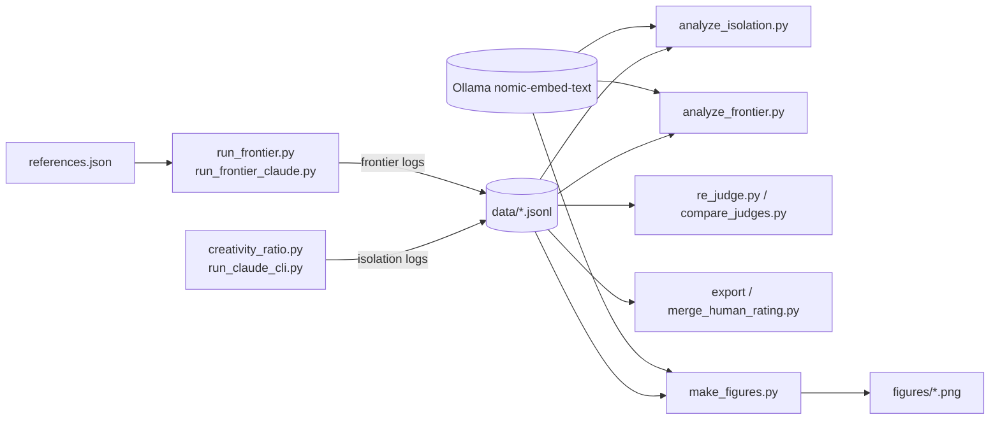
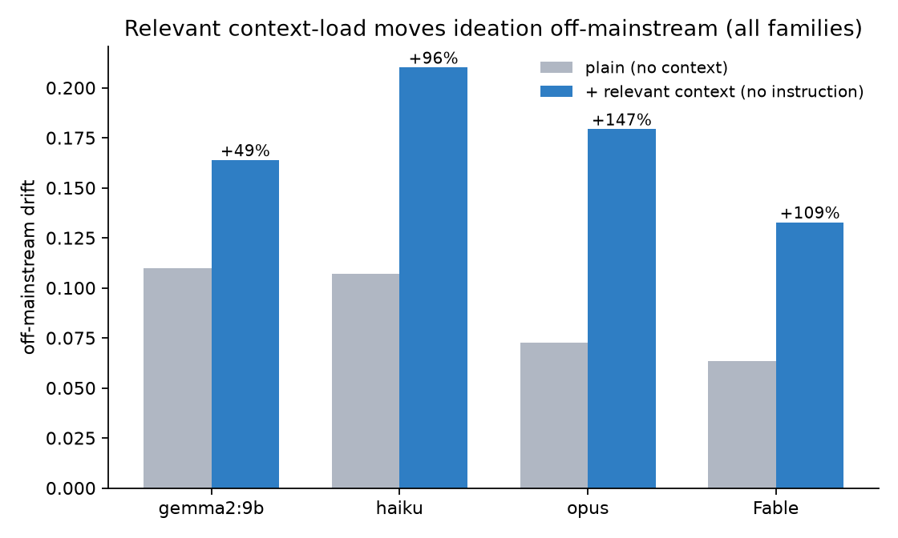
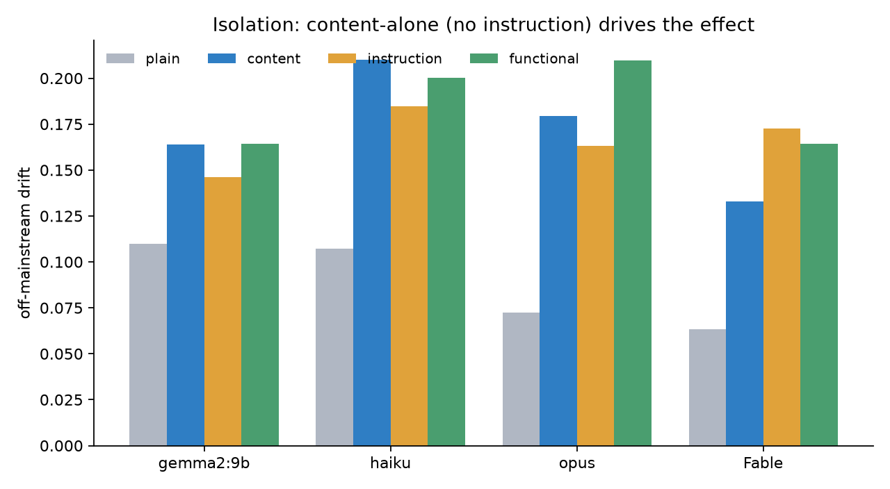
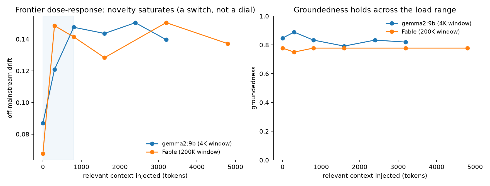

# Relevant Context-Load as a Saturating Novelty Knob: paper package

Harness, raw per-idea logs, figures and preprint for a cross-family study of whether the amount of
relevant context in a language model's window changes the novelty of its ideas, for readers who
want to check or extend the result.

**Published:** Zenodo, concept DOI [10.5281/zenodo.21149156](https://doi.org/10.5281/zenodo.21149156) (saluca community, CC-BY-4.0). Preprint, not peer-reviewed.

## Status

Research artifact, published 2026-07-03 as version 1 of the Zenodo record. The released logs in
`data/` and the analysis and figure scripts in `code/` reproduce the paper's isolation and
frontier tables and its three figures (checked 2026-10-22, see Quickstart). The scripts were
written for a parent checkout with a different layout, so they do **not** run from this clone
as released; the Quickstart stages the files into the layout they expect. Generation needs a
local Ollama for gemma2:9b and the Claude CLI for the Claude models.

> **Correction, 2026-10-22.** This README said "Regenerate figures from the raw logs with
> `code/make_figures.py`". From a clean clone that command fails with `FileNotFoundError`: the
> scripts read logs from `data/raw_logs_saluca/creativity/` (and `.../frontier/`), write figures
> to `saluca/paper/figures/`, and the generators load `saluca/references.json` and
> `saluca/creativity_ratio.py`, none of which exist here. The Quickstart below gives the staging
> steps that make the released scripts run unchanged. This README also listed pre-submission open
> items (an author-name placeholder, confirming the licence). Those were stale: the preprint was
> published on Zenodo on 2026-07-03 with the author named, and an Apache-2.0 `LICENSE` was added
> on 2026-08-18. The remaining strengthening items are kept below as future work.

### The finding, in one paragraph

Relevant context injected as neutral reference (no "be different" instruction) reliably moves LLM
ideation off the mainstream answer, replicated on gemma2:9b, haiku, opus, and Fable (+49% to
+147%), groundedness preserved. An isolation design shows it's the *load*, not an implicit
instruction. But it is a **saturating switch, not a dial**: novelty saturates within a few
hundred tokens and plateaus, and there is **no optimal input/window ratio**. The threshold is
absolute (~a few hundred tokens) and scale-invariant; the frontier model saturates *sooner* (~300
vs ~800 tokens).

### Not done (future work)

- More seeds; a stronger or human groundedness judge beyond the single blinded rater; a
  non-reasoning cloud family; probing beyond 54% of the window on a small-window model.
- Expert-graded value: the paper's metrics give the load-response shape, not domain-expert
  judgment of the ideas.

## Install

Tested 2026-10-22 with Python 3.12.10, numpy 2.4.6, requests 2.33.0, matplotlib 3.10.9,
openai 2.16.0 and Ollama 0.34.4. There is no `requirements.txt`.

```bash
git clone https://github.com/saluca-labs/context-load-novelty
cd context-load-novelty
pip install numpy requests matplotlib openai
ollama pull nomic-embed-text   # embeddings for novelty (drift); needed by the analysis scripts
ollama pull gemma2:9b          # only to generate new ideas
```

## Quickstart

Re-analyse the released logs and regenerate the figures. The analysis embeds every idea through
the local Ollama (`http://localhost:11434/api/embed`, `nomic-embed-text`), so Ollama must be
running; `make_figures.py` took about 45 seconds.

```bash
# stage the released logs where the scripts expect them
mkdir -p data/raw_logs_saluca/creativity/frontier saluca/paper/figures
cp data/ideas_*_isolation.jsonl data/raw_logs_saluca/creativity/
cp data/ideas_frontier_*.jsonl data/raw_logs_saluca/creativity/frontier/

python code/analyze_isolation.py
python code/analyze_frontier.py
python code/make_figures.py      # writes saluca/paper/figures/fig1..fig3
```

Part of the `analyze_isolation.py` output from that run (the verdict line after each table is
omitted here):

```
=== ollama_gemma2-9b_isolation ===
condition      n  grounded   drift  diverge  in_tok
--------------------------------------------------
plain         30     0.900   0.110    0.450      70
content       30     0.892   0.164    0.446     142
instruction   30     0.850   0.146    0.470      83
functional    30     0.867   0.164    0.441     161
```

and of `analyze_frontier.py`:

```
=== gemma2-9b ===
  load  ratio   n  grounded   drift  diverge
----------------------------------------------
     0   0.02  18     0.847   0.087    0.437
   300   0.07  18     0.889   0.121    0.421
   800   0.15  18     0.833   0.148    0.449
  1600   0.28  18     0.792   0.144    0.437
  2400   0.40  18     0.833   0.150    0.460
  3200   0.54  18     0.819   0.140    0.459
```

The regenerated `fig1_cross_family.png` and `fig3_frontier.png` were compared by eye with the
committed `figures/` and match (same values and labels: +49%, +96%, +147%, +109%).

## Usage

The generators (each logs the JSONL schema the analysis scripts read). They also expect the
`saluca/` layout, so stage it first:

```bash
mkdir -p saluca && cp code/references.json code/creativity_ratio.py saluca/

# isolation design on a local model (plain / content / instruction / functional)
python code/creativity_ratio.py --provider ollama --gen local:gemma2:9b --load-type isolation --seeds 8

# frontier dose-response on a local model
python code/run_frontier.py --model gemma2:9b --seeds 6

# Claude models via the Claude CLI (`claude -p`), judged by local gemma2
export OPENAI_BASE_URL=http://localhost:11434/v1 OPENAI_API_KEY=ollama
python code/run_claude_cli.py --model haiku --seeds 3
python code/run_frontier_claude.py --model claude-fable-5 --seeds 3
```

These commands are taken from the scripts' own usage notes (translated from PowerShell) and were
not re-run on 2026-10-22. The Claude scripts hard-code the CLI path of the original author's
machine (`CLAUDE = ...` near the top of each file); edit it to your own `claude` executable before
running. To keep host hooks out of the output they run the CLI against a temporary config
directory and copy your `~/.claude/.credentials.json` into it.

Judging and human rating:

- `code/re_judge.py --judge opus`: re-scores groundedness with a stronger judge.
- `code/compare_judges.py`: gemma2 judge vs opus judge.
- `code/export_human_rating.py` then `code/merge_human_rating.py`: the blinded human pass;
  `human_rating/RATING_INSTRUCTIONS.md` is the rubric and `human_rating/rate_me.csv` the rated
  sheet.

## Architecture

The isolation design generates four conditions per domain and seed (`plain`, `content`,
`instruction`, `functional`) to separate load from instruction; the frontier design injects an
increasing amount of relevant reference text (`code/references.json`) and measures drift,
groundedness and divergence against load. Novelty is embedding drift from the domain's baseline
centroid; groundedness is an LLM judge score, cross-checked by a stronger judge and a blinded
human rater.



Contents:

- `paper.pdf` / `paper.md`: the preprint (figures embedded).
- `figures/`: fig1 cross-family, fig2 isolation, fig3 frontier dose-response (PNG, 160 dpi).
- `code/`: all generation, judging, analysis, and figure scripts + `references.json` (reference corpora).
- `data/`: raw per-idea JSONL logs (isolation ×4 models, frontier ×2 models, plus the earlier pad/functional sweeps).
- `human_rating/`: the blinded rating sheet and rubric.
- `.zenodo.json`: Zenodo deposition metadata. `deposit_zenodo.py` and `.zenodo_draft.json` are the
  author's deposit tooling and record of the published deposit; they are not part of the study.

`code/smoke_local.py`, `code/run_confound.py` and `code/analyze_confound.py` belong to the
companion world-model-collapse confound study referenced in the paper's introduction. They import
a `src` package that is not in this repository and do not run here.

## Screenshots

The three figures as released (they regenerate from `data/` with the Quickstart):







## Citation

Ruvalcaba, C. and the Saluca Agentic AI Research Team (2026). *Relevant Context-Load as a
Saturating Novelty Knob in Language Models: A Cross-Family Study.* Zenodo.
https://doi.org/10.5281/zenodo.21149156

That is the concept DOI, which always resolves to the latest version. This README previously cited
the version 1 DOI, 10.5281/zenodo.21149157, which remains valid for that version. See
[`CITATION.cff`](CITATION.cff).

## License

The repository's [`LICENSE`](LICENSE) is Apache-2.0 (added 2026-08-18) and does not carve out
the data, figures or paper. The Zenodo record of the preprint is published under CC-BY-4.0.

## Links

- Preprint: https://doi.org/10.5281/zenodo.21149156 (concept DOI)
- Zenodo record, version 1: https://zenodo.org/records/21149157

_Last updated: 2026-10-22_
